# A8 – Gears

## Objective

The objective of this assignment was to design a gearbox which can be assembled and disassembled. The spur gears have a gear ratio of 24:9 and are listed in the resource section. The output gear torque and speed are to be 1.25 in-lbf and 1100 rpm relative. The input (pinion,power-transmission) and output (gear, short shaft) shaft diameters are .125 and .25 inches respectively and each have a length of 1 inch. Use the appropriate equations in the Machinery’s Handbook for empirical units. The critical features of the gearbox include the shafts, and the journal bearings.

## Design of the Shafts

the first thing i was to do was to calculate the stresses on the shafts and make sure their diameter and size is sufficient enough. I am making the shafts based of this these gears.  

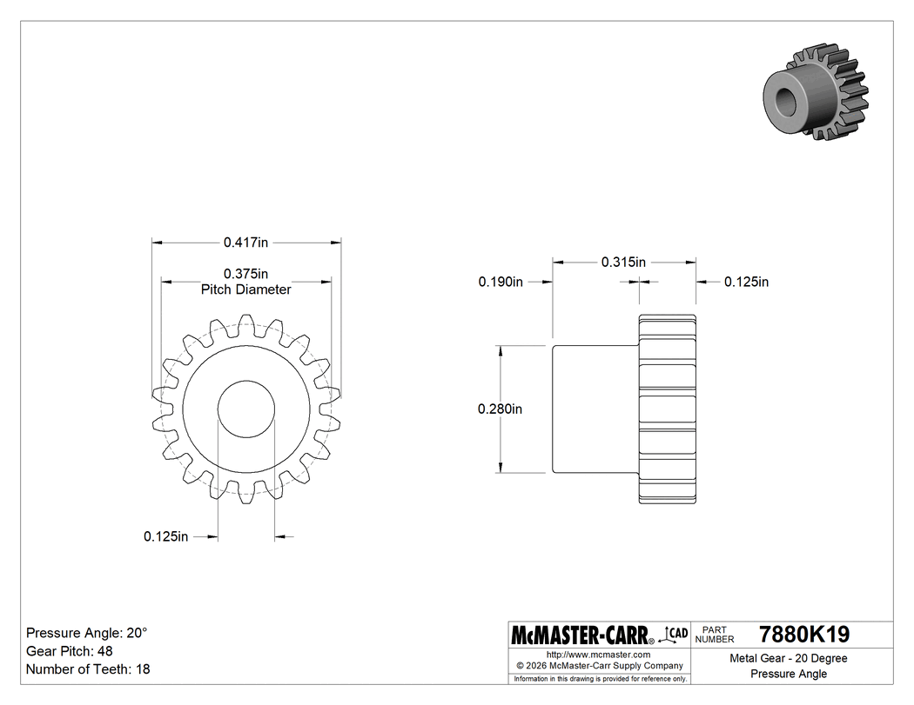

based of of these gars i then made a free body diagram and calculated the stresses for both the input and output shafts 

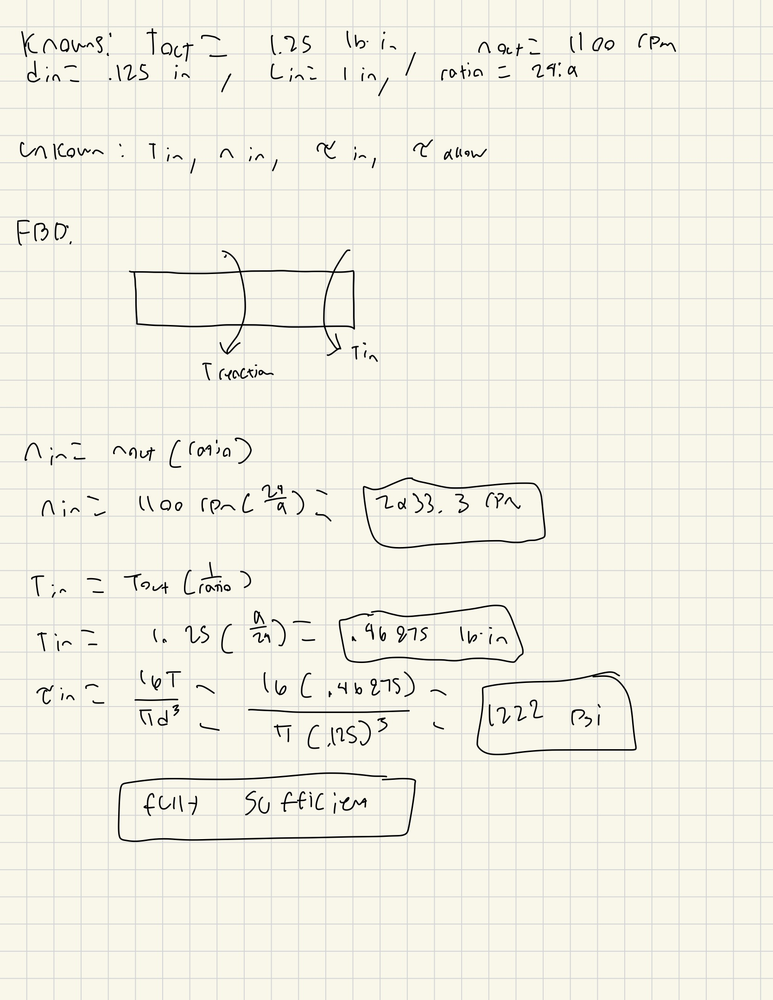

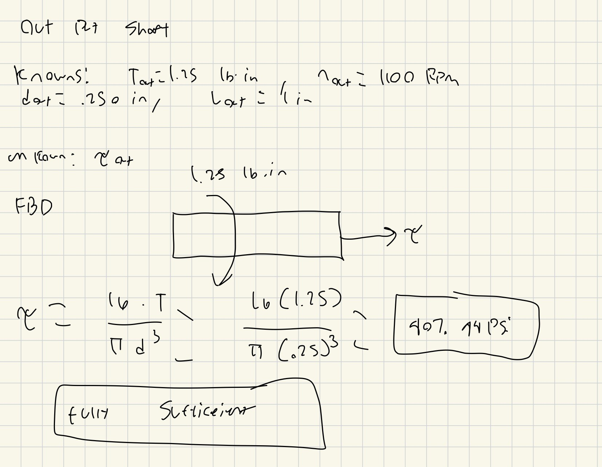

I have found that both of the shafts are sufficient so my next step was to find which journal bearings are best fir for this gearbox. looking through the website i found that the bronze oiled coated bearings were bet suited for my stresses and outputs and i just had to find the thicknesses of each. 

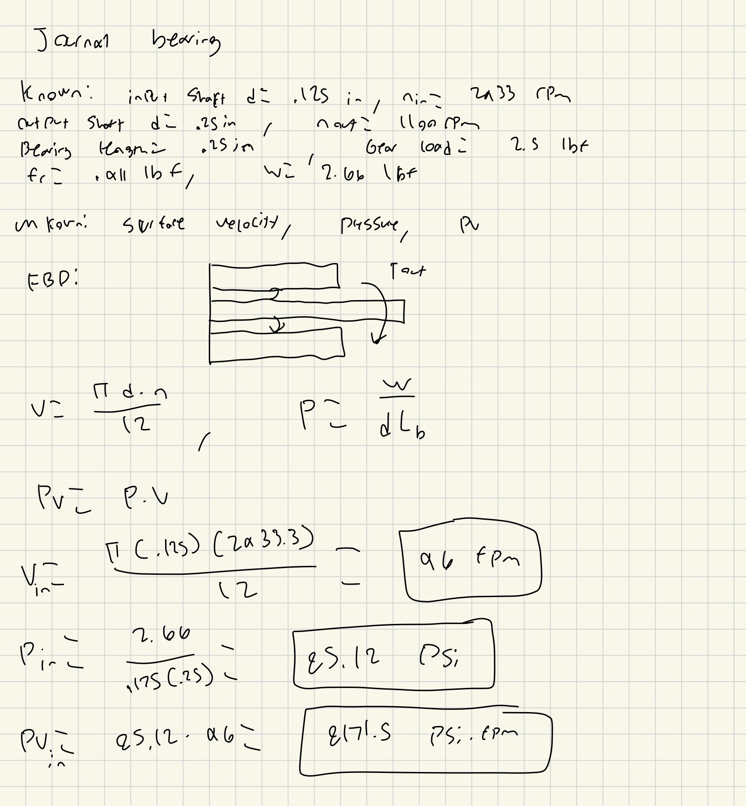

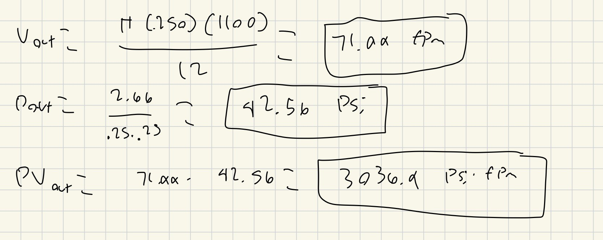

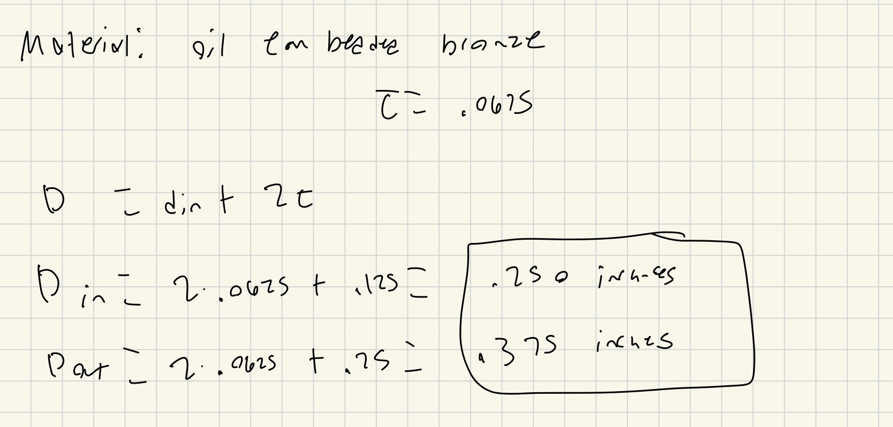

Then I did a final sketch of my gear box housing with the gears inside them.

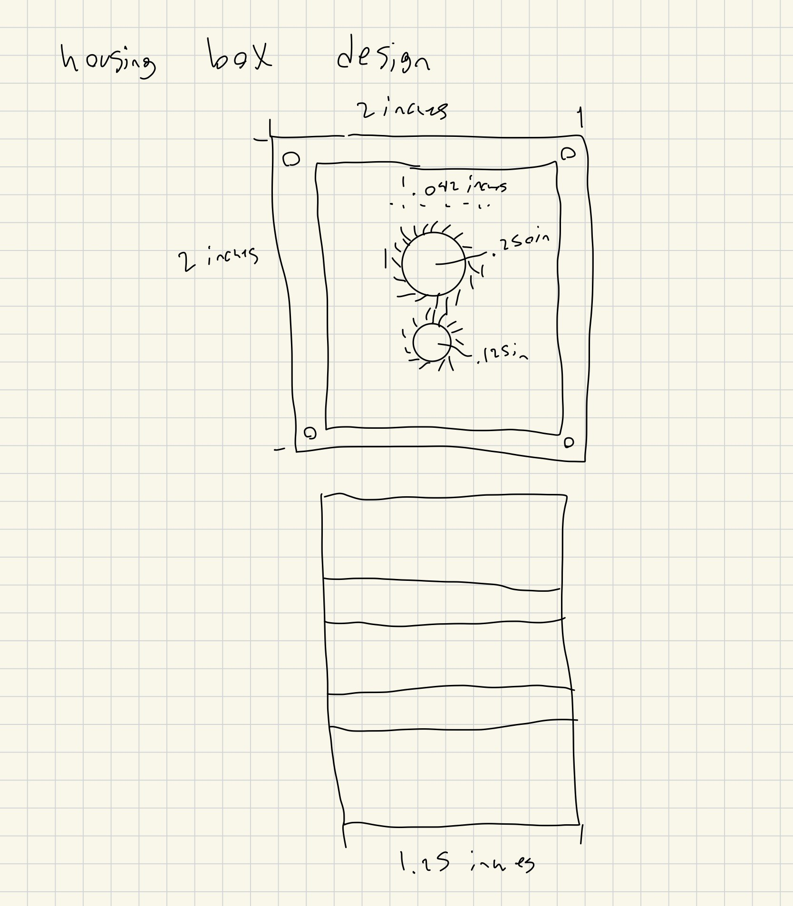

## CAD Modeling

Next is started to work on the CAD modeling for this gearbox. I started with importing my gears and then making my journal bearings and shafts. Last i made my gearbox housing and now that i had all my parts I assembled them all together. 

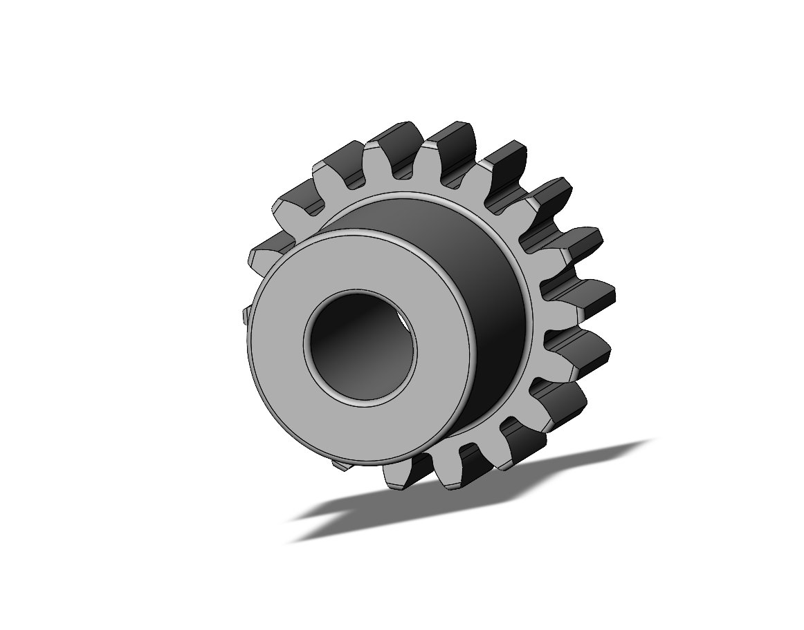
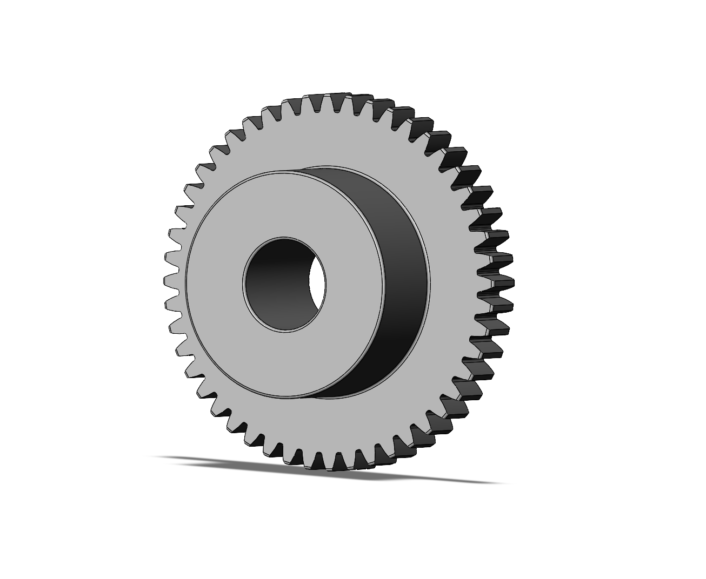
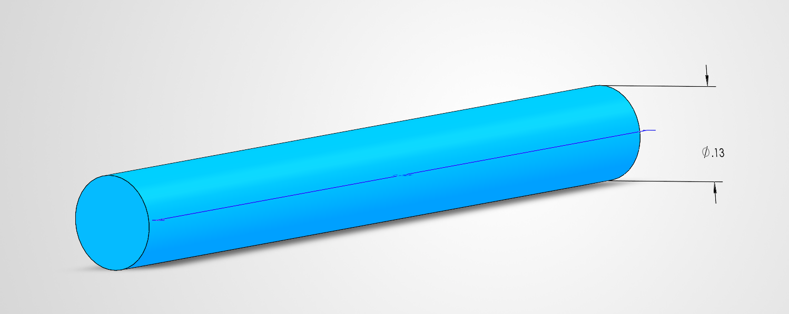
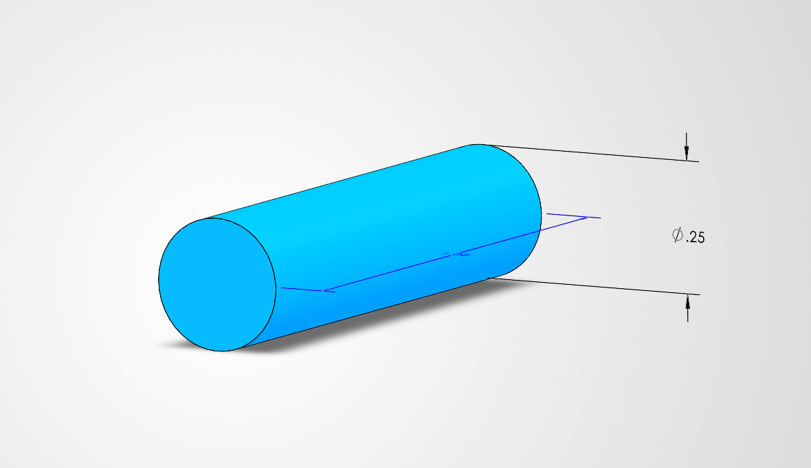

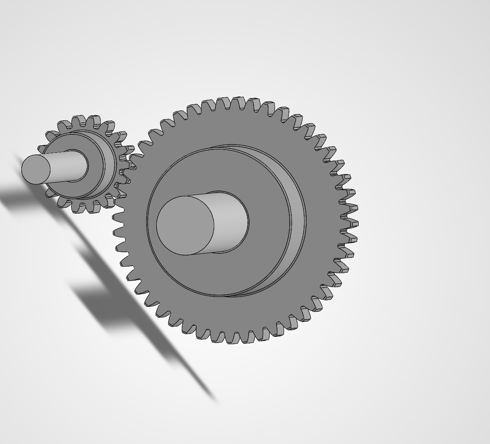

[Shaft 1 download](.125_shaft.SLDPRT)
[Shaft 2 download](.25_shaft.SLDPRT)

## Communicate

