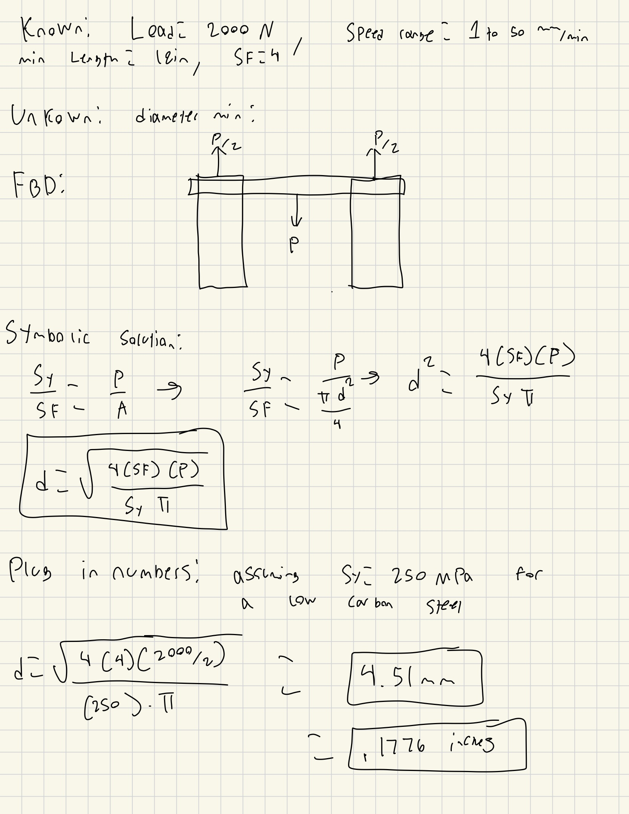

# A10 – Lead Screw Translating System

## Objective  
A brief introduction to the purpose behind our Lead Screw:  
The machine we are designing this lead screw for is a tensile tester. It is a mechanical testing device used to measure how material responds to uniaxial tension. It applies a controlled pulling force to a specimen while recording the resulting elongation, allowing engineering to determine properties such as **yield strength, ultimate tensile strength, and elongation at break.** This data is essential for understanding a material's mechanical behavior and suitability for design applications.  
The object our assignment is to design and build a mechanically driven tensile tester capable of applying up to **2kN axial tensile load** with a controllable crosshead speed from **1 - 50mm/min**. Our team is responsible for the mechanical components outlined below. The system will provide consistent, well-aligned loading for polymers and light metals, suitable for instructional use and basic material evaluation.  
- Develop a **lead-screw driven crosshead**  
- Ensure **accurate, repeatable load application** to 2kN with minimal crosshead deflection and misalignment.  
- Provide **robust specimen gripping**, simple calibration provisions (mechanical), safe, and ergonomic operation.  
Constrains:  
- Purely Mechanical  
- Load capacity: 2kN (with appropriate safety factor in structure and drivetrain)  
- Speed Range: 1-50 mm/min (achieved via lead selection)  
- Form factor: bench-top footprint favored; manageable overall height; 18 inch leadscrew minimum  
- Safety Factor: 4  

## Analyze  

### Lead Screw Selection (Justin Adelman)

The first part of this assignment was to select the correct lead screw by solving for its minimum diameter, range of rotational speed, and the max torque provided. I started with determining the minimum diameter needed and by listing out all of the knowns and unknows. We know the load put on the whole system, the min length of the screw, the safety factor, the speed range, and I assumed the material strength based off of low carbon steel. This showed me that the only unknown is the min diameter. Using the stress equation I was able to solve for area and in return solve for the needed diameter which is shown below. 

After solving and plugging the numbers in I got a minimum diameter of 4.51 mm or about .1776 so any 1/4(.250) inch lead screw would be sufficient for this design.  

The next thing to solve for was the rage of rotational speed based off of the needed corehaead speed and the picth og the lead screw.
  
  
  
  

## Tabulation:  
<a href="https://docs.google.com/spreadsheets/d/1-IyFBrPSqRsUC8X71TDrjAil2_3B7H-Nr4CGZBN8Lyw/edit?usp=sharing" target="Tabulation Link">A10 Tabulation Link</a> 

## Decide
_Reference your concept selection (Pugh matrix) here. How does this design follow from that decision?_

## Communicate

