# A10 – Lead Screw Translating System

## Objective  
### (Justin Hatcher)
A brief introduction to the purpose behind our Lead Screw:  
The machine we are designing this lead screw for is a tensile tester. It is a mechanical testing device used to measure how material responds to uniaxial tension. It applies a controlled pulling force to a specimen while recording the resulting elongation, allowing engineering to determine properties such as **yield strength, ultimate tensile strength, and elongation at break.** This data is essential for understanding a material's mechanical behavior and suitability for design applications.  
The object our assignment is to design and build a mechanically driven tensile tester capable of applying up to **2kN axial tensile load** with a controllable crosshead speed from **1 - 50mm/min**. Our team is responsible for the mechanical components outlined below. The system will provide consistent, well-aligned loading for polymers and light metals, suitable for instructional use and basic material evaluation.  
- Develop a **lead-screw driven crosshead**  
- Ensure **accurate, repeatable load application** to 2kN with minimal crosshead deflection and misalignment.  
- Provide **robust specimen gripping**, simple calibration provisions (mechanical), safe, and ergonomic operation.  
Constrains:  
- Purely Mechanical  
- Load capacity: 2kN (with appropriate safety factor in structure and drivetrain)  
- Speed Range: 1-50 mm/min (achieved via lead selection)  
- Form factor: bench-top footprint favored; manageable overall height; 18 inch leadscrew minimum  
- Safety Factor: 4  

## Analyze  

### Lead Screw Selection (Justin Adelman)

The first part of this assignment was to select the correct lead screw by solving for its minimum diameter, range of rotational speed, and the max torque provided. I started with determining the minimum diameter needed and by listing out all of the knowns and unknows. We know the load put on the whole system, the min length of the screw, the safety factor, the speed range, and I assumed the material strength based off of low carbon steel. This showed me that the only unknown is the min diameter. Using the stress equation I was able to solve for area and in return solve for the needed diameter which is shown below. 

After solving and plugging the numbers in I got a minimum diameter of 4.51 mm or about .1776 so any 1/4(.250) inch lead screw would be sufficient for this design.  

The next thing to solve for was the rage of rotational speed based off of the needed crosshead speed and the pitch of the lead screw. From my min diameter calcualtion i assumed a pitch of 1/16 or .063 inches. Since we know the needed linear speed which is 1-50mm/min I can using the rotational speed formula to solve for the min and max rotational speed.  

The last thing i need before I select the lead screw is to calculate the max torque to provide the 2KN tension to test the sample. I listed out all of my knowns and unknowns and saw I already have everything i need and just need to solve for the torque with the equation given to us shown below.  
 
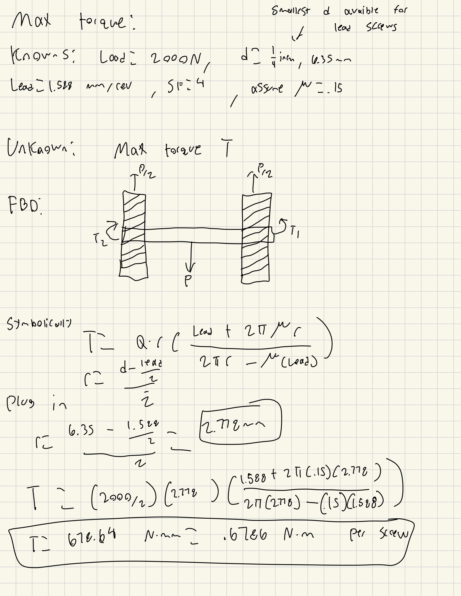 

After plugging in my number i got the max torque to be .6786 N-m per screw as the load an torque is distributed between the two screws. From all of my calculations for the diameter, the rotational speed range, and the max torque i selected the 1018 Carbon Steel Precision Acme Lead Screw, Right Hand, 1/4"-16 Thread Size, 18" Long as it matched all the requirements and calculated parameters best. 

[Lead Screw Link](https://www.mcmaster.com/99030A981/)

### Nut and Flange Selection (Justin Adelman)

Now that I had selected the lead screw I had to select the complimentary nut and flange for this design. I also had to make sure that the internal threads of the nut could support the load of the screw by using the thread bending stress  analysis. I know that the nut should bronze and it has to match the pitch of the lead screw so it also must be 1/16 as well. I am assuming the length of the nut to be 5/8 inch since that is the most common size. Based off the length and pitch i was able to calculate how many thread are touching/ are active during the load which is 10. from there i can plug the numbers into the stress bending equation shown below.       

  

I got max stress to me 101.05 MPA which is plenty below the yield strength of 673 bronze of 203 MPA. Also the calculated  101.05 used the safety factor of 4 so it well within all parameters. From this i selected a nut for this length material and internal pitch to match the screw which is linked here. 

[Link for Selected Nut](https://www.mcmaster.com/95072A881/)

This but had an external thread of 9/16 - 18 so all i had to do was to select a flange that would match this pitch and allow the nut to thread in and connect which is linked here.

[Link for Selected Flange](https://www.mcmaster.com/95082A641/)

### Designing the Crosshead (Justin Hatcher)  
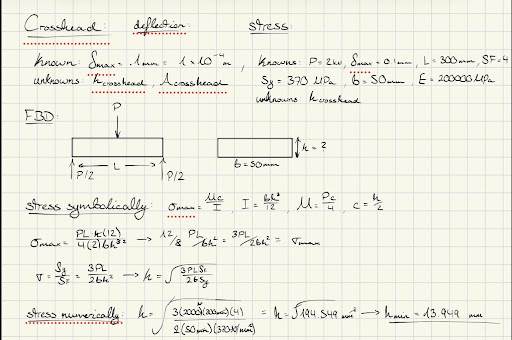  
Calculations and assumptions for designing our crosshead suitable for leadscrews and frame of our machine. Analyzing the minimum strength required for the load and the maximum deflection of .1mm. We were able to determine the size and material needed to successfully complete the goal of this assignment. Using the web, we found an appropriate length of the crosshead using the nut flange width to find the minimum base size to allow there to be enough surface mating area between the two parts.  

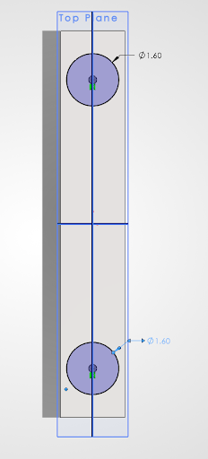  
After extruding the parameters of the cross section of the cross head, I was able to mark the distance between the leadscrews with a circle that resembles the base of the flanges.  
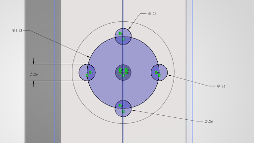  
Inserting the circular pattern for the bolt holes on the flange according to the base of the flange.  
  
Final view from above of the crosshead to see that bolt inserts for flange are visible and leadscrew hole goes all the way through the part.  
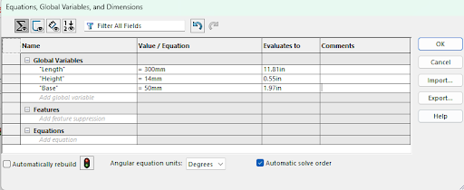  
And lastly, parametric design of the crosshead given the important parameters needed.  

### Assembly: (Jackson Rice)  
Now that everything was designed we just had to assemble it. First was the crosshead assembly. This consisted of two leadscrews, the crosshead itself, two flanges, and two nuts.  
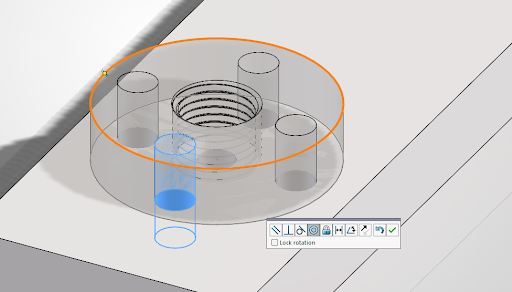  
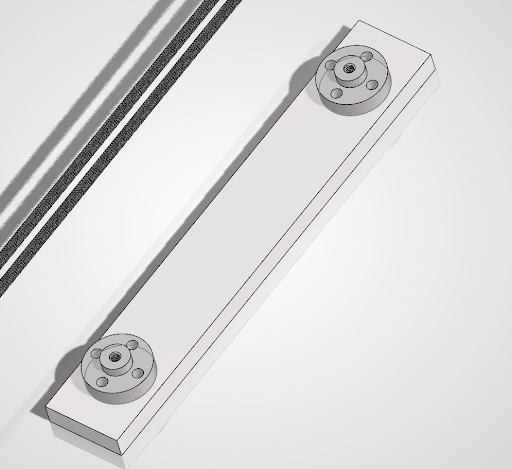  
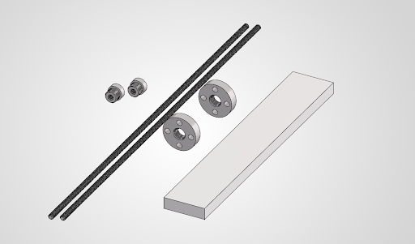  
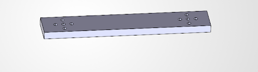  
  
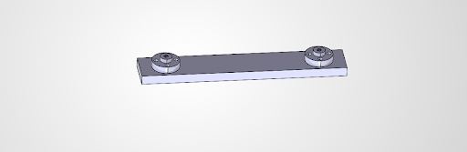  
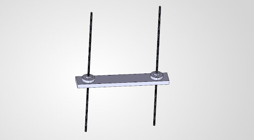  
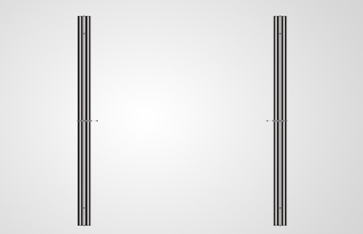  
Now was time for the full assembly. This was just the crosshead assembly and the frame. The frame had to be assembled part by part which proved more difficult than I first thought. I had to find the right size and at first the smallest size was 1 meter, which was way too big. I eventually found the right sizes and assembled the frame.  
  
  
  
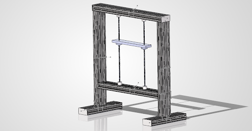  

### Frame Selection (Jackson Rice)  
  
2ft frame  
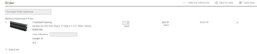  
3ft frame  

### Tabulation  (Justin Hatcher)  

<a href="https://docs.google.com/spreadsheets/d/1-IyFBrPSqRsUC8X71TDrjAil2_3B7H-Nr4CGZBN8Lyw/edit?usp=sharing" target="Tabulation Link">A10 Tabulation Link</a> 

## Decide
_Reference your concept selection (Pugh matrix) here. How does this design follow from that decision?_

## Lessons Learned 
Jackson Rice: In this project I learned a lot. The thing that I found most useful however was the assembly. Assembly was a big part of this assignment and, admittedly, I had some trouble at the start. As I ran into problems and found solutions I learned a lot about mating, orientation, and other things. This will prove very useful in future projects.  

Justin H. : During the course of the project I learned how valuable it was to make a checklist of the variable and parameters we were given for this project and what actually fits together. Taking extra time to look at parts to find a good part is better than being fast and throwing something together knowing it probably won't work because of a time constraint.  

Justin Adelman: This project taught me a lot about the correct way to actually select items after having all the requirements. For example I had to go back and change my initial lead screw selection multiple times as there were no bronze nuts that could match the pitch for anything smaller than 1/16. This taught me to always think ahead and make sure all items are compatible and can work with each other.   

Time Taken: 5 hours(Jackson)
            5 hours(Justin H.)
            5 hours(Justin A)

### CAD Links:  
<a href="A10 (2).zip" download>Download A10 Solidworks Parts and Assmebly</a>  
