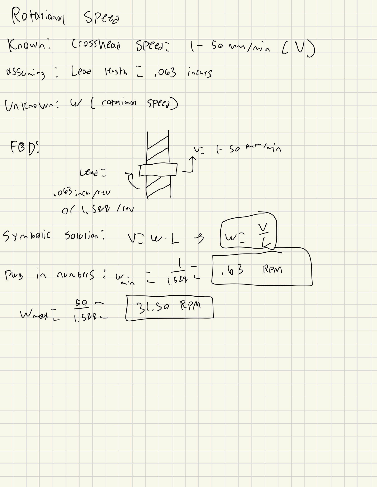
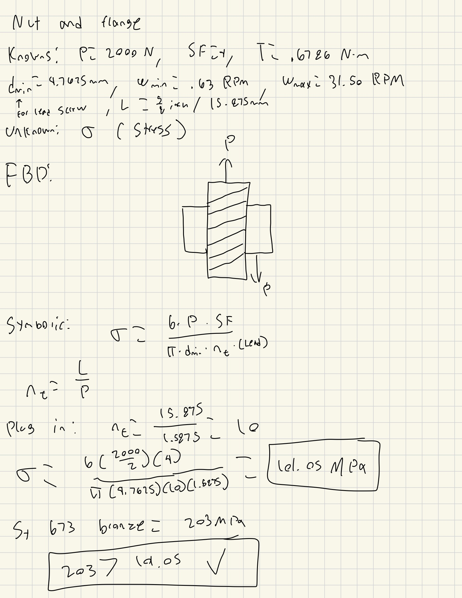
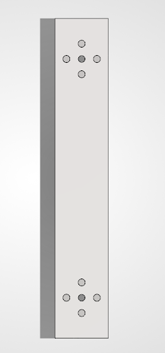
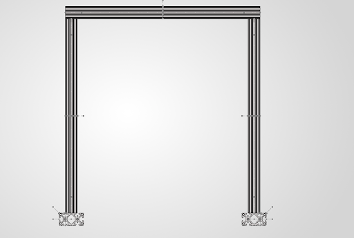
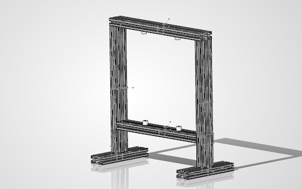
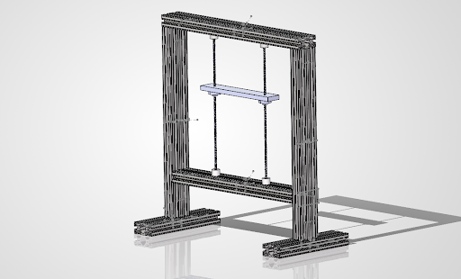
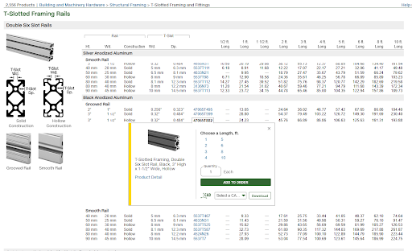

# A10 – Lead Screw Translating System

## Objective  
A brief introduction to the purpose behind our Lead Screw:  (Justin Hatcher)
The machine we are designing this lead screw for is a tensile tester. It is a mechanical testing device used to measure how material responds to uniaxial tension. It applies a controlled pulling force to a specimen while recording the resulting elongation, allowing engineering to determine properties such as **yield strength, ultimate tensile strength, and elongation at break.** This data is essential for understanding a material's mechanical behavior and suitability for design applications.  
The object our assignment is to design and build a mechanically driven tensile tester capable of applying up to **2kN axial tensile load** with a controllable crosshead speed from **1 - 50mm/min**. Our team is responsible for the mechanical components outlined below. The system will provide consistent, well-aligned loading for polymers and light metals, suitable for instructional use and basic material evaluation.  
- Develop a **lead-screw driven crosshead**  
- Ensure **accurate, repeatable load application** to 2kN with minimal crosshead deflection and misalignment.  
- Provide **robust specimen gripping**, simple calibration provisions (mechanical), safe, and ergonomic operation.  
Constrains:  
- Purely Mechanical  
- Load capacity: 2kN (with appropriate safety factor in structure and drivetrain)  
- Speed Range: 1-50 mm/min (achieved via lead selection)  
- Form factor: bench-top footprint favored; manageable overall height; 18 inch leadscrew minimum  
- Safety Factor: 4  

## Analyze  

### Lead Screw Selection (Justin Adelman)

The first part of this assignment was to select the correct lead screw by solving for its minimum diameter, range of rotational speed, and the max torque provided. I started with determining the minimum diameter needed and by listing out all of the knowns and unknows. We know the load put on the whole system, the min length of the screw, the safety factor, the speed range, and I assumed the material strength based off of low carbon steel. This showed me that the only unknown is the min diameter. Using the stress equation I was able to solve for area and in return solve for the needed diameter which is shown below. 

After solving and plugging the numbers in I got a minimum diameter of 4.51 mm or about .1776 so any 1/4(.250) inch lead screw would be sufficient for this design.  

The next thing to solve for was the rage of rotational speed based off of the needed crosshead speed and the pitch of the lead screw. From my min diameter calcualtion i assumed a pitch of 1/16 or .063 inches. Since we know the needed linear speed which is 1-50mm/min I can using the rotational speed formula to solve for the min and max rotational speed.  

The last thing i need before I select the lead screw is to calculate the max torque to provide the 2KN tension to test the sample. I listed out all of my knowns and unknowns and saw I already have everything i need and just need to solve for the torque with the equation given to us shown below. 
 
 

After plugging in my number i got the max torque to be .6786 N-m per screw as the load an torque is distributed between the two screws. From all of my calculations for the diameter, the rotational speed range, and the max torque i selected the 1018 Carbon Steel Precision Acme Lead Screw, Right Hand, 1/4"-16 Thread Size, 18" Long as it matched all the requirements and calculated parameters best. 

[Lead Screw Link](https://www.mcmaster.com/99030A981/)

  

### Designing the Crosshead (Justin Hatcher)  
  
Calculations and assumptions for designing our crosshead suitable for leadscrews and frame of our machine. Analyzing the minimum strength required for the load and the maximum deflection of .1mm. We were able to determine the size and material needed to successfully complete the goal of this assignment. Using the web, we found an appropriate length of the crosshead using the nut flange width to find the minimum base size to allow there to be enough surface mating area between the two parts.  

  
After extruding the parameters of the cross section of the cross head, I was able to mark the distance between the leadscrews with a circle that resembles the base of the flanges.  
  
Inserting the circular pattern for the bolt holes on the flange according to the base of the flange. 
  
Final view from above of the crosshead to see that bolt inserts for flange are visible and leadscrew hole goes all the way through the part.  
  

### Assembly: (Jackson Rice)  
  
  
  
  
  
  
  
  
  
  
  
  
  
  

### Tabulation:  (Justin Hatcher)  

<a href="https://docs.google.com/spreadsheets/d/1-IyFBrPSqRsUC8X71TDrjAil2_3B7H-Nr4CGZBN8Lyw/edit?usp=sharing" target="Tabulation Link">A10 Tabulation Link</a> 

## Decide
_Reference your concept selection (Pugh matrix) here. How does this design follow from that decision?_

## Communicate
### CAD Links:  
