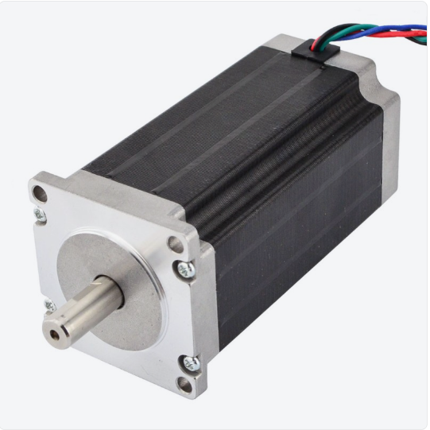
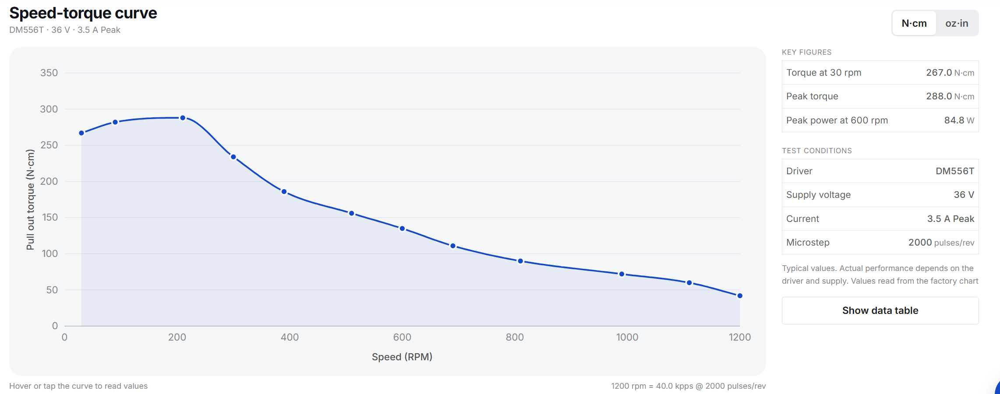

# A11 – Motor Selection

## Objective  
Our objective this week is develop the motorized drive and structural integration for the 2kN tester, focusing on motor selection, mounting, frame stability, and clamp design. This phase will ensure that the crosshead moves smoothly under controlled torque and speed while maintaining precise load alignment and secure specimen gripping. The motor selection will be based on our data calculated last week through the analysis of the leadscrew, flange, nut, frame and crosshead.  

Key Constraints: 
- No electronics, no software: purely mechanical.
- Load capacity: 2kN (with appropriate safety factor in structure and drivetrain).
- Speed range: 1-50 mm/min (achieved via lead screw selection).
- Form factor: bench-top footprint favored; manageable overall height; 18 inch lead screw minimum
- Safety Factor : 4

Outline:  
1): Motor Selection  
2): Designing Motor Bracket housing  
3): Select or designing coupler  
4): Select connectors for frame
5): FEA for the top of frame  
6): FEA on vertical components of frame  
7): Designing a floating bearing mount  
8): Tabulation  
9): Lessons learned   

## Analyze
### Motor Selection

From the last assignment i learned that with my 1/4 inch lead screw the required toque for each motor would be .6786 N-m and the rotational speed range for this torque is .63 - 31.5 RPM. Based off of this i reachred a;l type of motors and landed on the Nema 23 Bipolar 3Nm(425oz.in) 3.5A 57x57x113mm 4 Wires CNC Stepper Motor. 

[Link to Motor](https://www.omc-stepperonline.com/nema-23-bipolar-3nm-425oz-in-3-5a-57x57x114mm-4-wires-cnc-stepper-motor-23hs45-3504s)

The reason i selected this motor is because first it is a steeper motor which allows it to control its speed and also knows its location so it can be used for precise movements. Second it has a 3nm torque rating which is well above the required torque of .6786 N-m so it has a built and safety factor. Also by looking at its torque speed graph we can see that under 31.5 RPM it still has a output torque of 2.67 N-m which is plenty for this lead screw design. 

### Coupler Design

The nest thing to do was to design a coupler that would connect the lead screw to the motor shaft. I first started out by listing all my knowns. I knew the inetrnal diamater of the coupler must be 10 mm as that is the shaft size of the motor, the material of the coupler will be steel so its yeild strength is 250 MPA, and lastlty i know the torque applied to the coupler will be .6785 N-m. From these i know i need to solve for the outer diamatter/ size fo the coupler so it can withstand the torque applied. 

From my calcualtions I see that i need an outer dimater of at least 10.13 mm but i decided to round up to 10.5 mm to be eaiser to acutlly manufacter and to have a built in extra saftey factor
## Decide
_Reference your concept selection (Pugh matrix) here. How does this design follow from that decision?_

## Communicate
